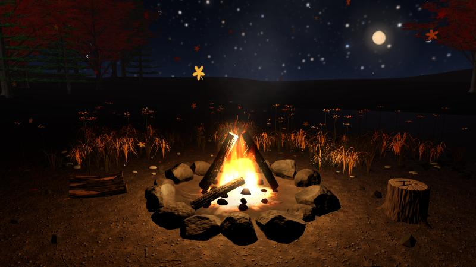

# 焚火（takibi）

作業中のパソコンで、パチパチと鳴る焚火をバックグラウンドに流しておくためのツールです。ブラウザで開くだけで動きます。

**使ってみる → https://tsaru23.github.io/takibi/**



## 動画の焚火と違うところ

焚火の動画は同じ映像と音の繰り返しで、音量くらいしか変えられません。このツールは音をその場で合成しているので、同じ鳴り方は二度とありません。パチパチの頻度や大きさ、画面の明るさも自分の好みに合わせられます。

薪は時間とともに燃え尽きて、最後は赤い熾火になります。画面をクリックすると薪を1本くべられて、火はいったん弱まってから大きく燃え上がります。放っておいても消えないように、薪を自動で足す設定もあります。

## できること

- 焚火の音：低い燃焼音、ランダムなパチパチ、ときどき大きくはぜる音
- 調整：明るさ、パチパチの頻度と大きさ、燃焼音の音量、全体の音量、燃える速さ
- シーン：7つから選べます
  - 季節の木：森の中の焚火です。春は桜、夏は緑の広葉樹、秋は赤いもみじ、冬は針葉樹が周りを囲み、正面には夜空が開けています
  - 洞窟：焚火の光が岩壁で揺らめき、入口の向こうにだけ夜空と月が見えます。天井から水滴が落ち、音には洞窟の残響がかかります
  - 川：焚火の奥を川が流れ、岩の周りで白く泡立ちます。手前は丸石の河原です
  - 海：砂浜の焚火です。月の光が海面に道を作り、波が寄せては引いていきます。波の動きは、さざ波の音の強弱に合わせてあります
  - ログハウス：窓から暖かい光が漏れる小屋の前です。ポーチのランタン、薪棚、斧の刺さった切り株があり、遠くでフクロウが鳴きます
  - 池：焚火の奥に夜の池が広がります。水面には月と焚火の光が揺らいで映り、蓮の葉の上で蛙が喉を膨らませて鳴きます。錦鯉がときどき顔を出して「ちゃぽん」と鳴り、メダカは群れで向きを変えながら泳ぎます。夏は蓮の花とホタルが増え、秋は落ち葉が浮かび、冬は池の縁が凍って鯉は深いところでじっとしています
  - 庭園・竹藪：20〜40秒おきに鹿威しが水をためて傾き、「カコーン」と鳴ります。石灯籠、縁台の盆栽（松・もみじ・梅）、風にしなる竹藪、枯山水の砂紋があり、季節で梅や紅葉、雪が変わります
- 季節：春・夏・秋・冬で空の色、月の高さと色、舞うもの（桜、紅葉、雪）が変わる。起動した月の季節が自動で選ばれる
- 夜空：背景の星空に、月と星のまたたき、ときどき流れ星が出る。設定でオフにすると暗いグラデーションになる
- ホタル：黄緑の光がゆっくり明滅しながら漂う。夏は初期値でオン、ほかの季節はオフ。自分で切り替えた設定はそのまま残る
- 環境音：さざ波、虫の声、蛙の声、雨、風、竹のささやき、川の流れ、洞窟の風、フクロウ。虫の声と蛙の声は季節で鳴き方が変わり、冬は鳴かない。シーンを選ぶと、そのシーンに合う音が自動でオンになる。池・庭園・洞窟・ログハウスでは、水音や鹿威し、家のきしみなどの効果音も鳴る
- 季節限定の音：春はせせらぎ、夏は風鈴と遠くの花火、秋は落ち葉、冬はやかんと雪の静けさ
- 音だけモード：映像を止めてCPUの負荷を下げる
- 映像：石で囲んだ焚火を少し見下ろす視点で、360度見回せる。ホイールとピンチで寄り・引きもでき、ダブルクリックで正面に戻る。WebGL が使えない環境では映像を出さず、音だけで動く
- ゆっくり見回す：何も操作していない間、カメラが焚火のまわりを自動で1周する。1周の速さは8分・4分・2分から選べる。初期値はオフ。触ると止まり、少しして続きから回る
- 草の量：草地を「多い／ふつう／少ない／なし」から選べる。動きが重いときは自動で減らす
- スマホ：設定は画面の下から引き出す。画面をロックしたり別のアプリに切り替えたりしても、録音しておいた数分のループで音が続く（端末やOSによっては止まる）。画面をつけたままにする設定と、ホーム画面への追加にも対応

設定はブラウザに保存されるので、次に開いたときもそのまま使えます。

## 操作

| 操作 | 内容 |
|---|---|
| 画面をクリック、またはスペースキー | 薪をくべる |
| 右下の歯車 | 設定パネルを開く |
| H キー | 画面の操作ボタンを隠す |
| ドラッグ | 焚火のまわりを見回す |
| ホイール、ピンチ | 寄る・引く |
| ダブルクリック（ダブルタップ） | 視点を正面に戻す |

最初に「火をつける」を押すと音が鳴り始めます（ブラウザの仕様で、操作するまで音を出せないためです）。そのあとタブを裏に回しても、音は止まりません。

## しくみ

音声ファイルは1つも使っていません。焚火も環境音も、Web Audio API でノイズやサイン波を加工して、その場で作っています。たとえばパチパチは数ミリ秒のノイズを高い音域に絞ったもので、鳴る間隔はランダムです。

音の予約はタイマーで1.5秒先まで行っています。タブが裏に回るとブラウザは画面の更新を止めますが、この方式なら音は途切れません。

蛙の声は、こぎり波を帯域フィルターに通し、15〜30Hz の細かいパルスで揺らして作っています。鳴く時刻は音の予約時刻なので、蛙の喉の動きや鹿威しの動きと音がずれません。

映像は three.js（r185）をCDNから読み込みます。焚火・地面・夜空・ホタルなど共通の部分は `scene3d.js`、炎と火の粉は `fire3d.js`、シーンごとの内容は `scenes/` の中に1シーン1ファイルで置いています。ビルドは不要です。

## 手元で動かす

```bash
git clone https://github.com/tsaru23/takibi.git
cd takibi
python -m http.server 5173
```

ブラウザで http://localhost:5173 を開きます。ES モジュールを使うため、`index.html` のダブルクリックでは映像が出ません（音だけになります）。

## 参考にしたもの

焚火をくべて楽しむゲーム「チルっと焚火ソン」から着想を得ました。

## ライセンス

コードは MIT License です。アイコンには [Lucide](https://lucide.dev)（ISC License）を使っています。

草木（`assets/plants/` 以下）は、[FABOTANIC](https://amix-design.com/tl/fab-botanic/)（AMIX）で作った素材です。これらは MIT の対象外で、[FABOTANIC の利用条件](https://amix-design.com/tl/fab-botanic/license/1.0.0.html)に従います。素材だけを取り出して配布・販売することはできません。

詳しくは [LICENSE](LICENSE) を見てください。
